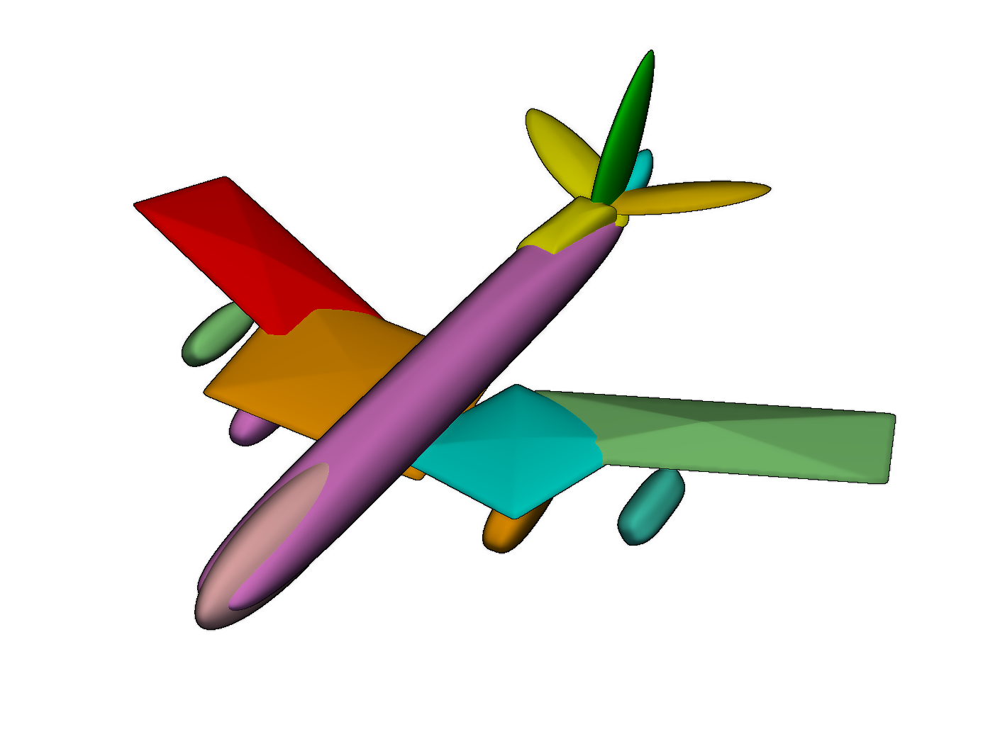
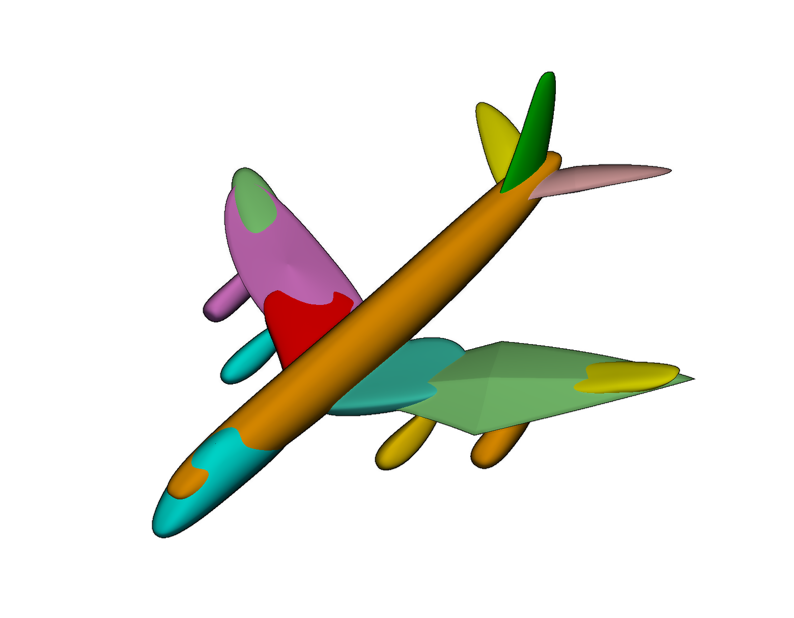
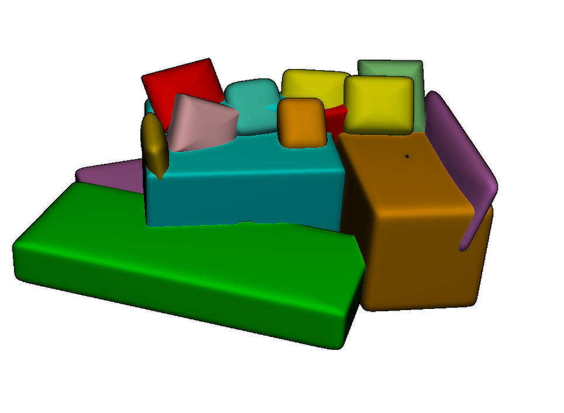
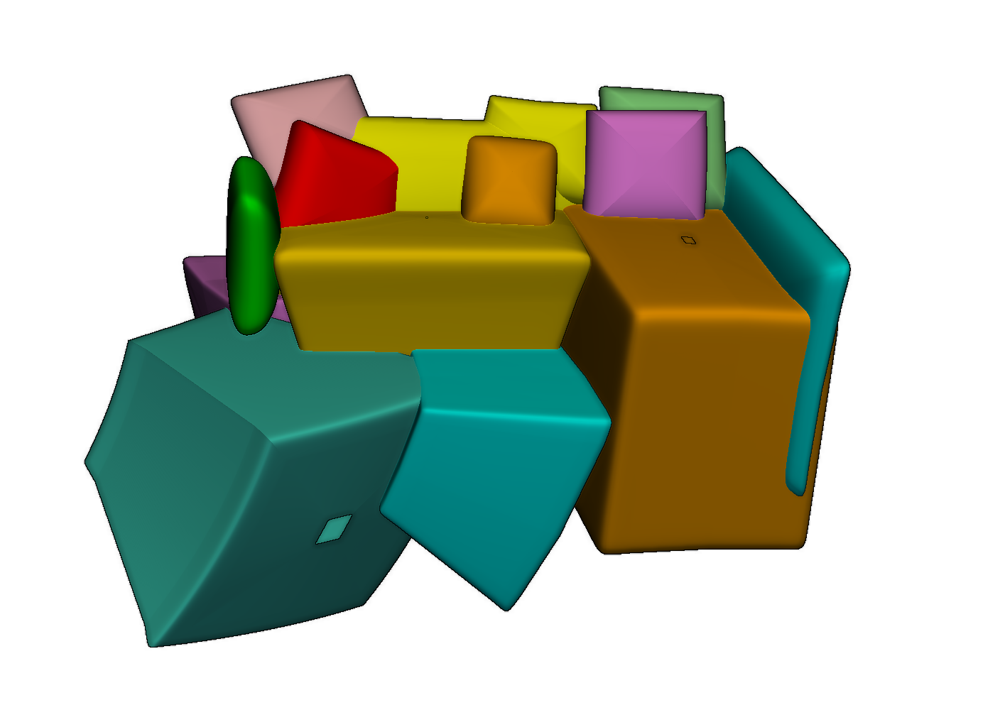
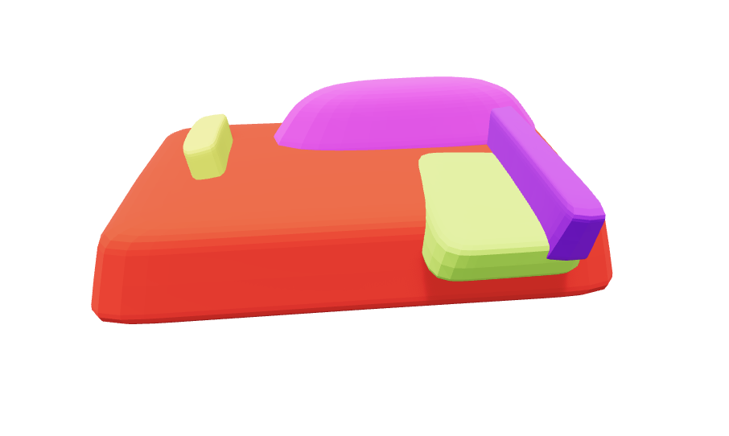

# GAIR_PRO — Metal-accelerated GAIR-RANSAC

GAIR_PRO extends the original **GAIR-RANSAC** algorithm for decomposing 3D point clouds into superquadrics. The pipeline launched through [`main_scan_pc.py`](main_scan_pc.py) adds **GPU acceleration with Metal on Apple silicon**, support for **19-parameter deformable superquadrics**, and a scoring criterion that penalizes primitives enclosing other point-cloud structures.

The optimized algorithm is **approximately 20× faster than the original GAIR-RANSAC**. This is an indicative speedup; runtime depends on the hardware, input cloud, and settings.

## Decomposition pipeline

The algorithm loads the input, obtains point normals, and builds a k-nearest-neighbor graph. It then samples point sets, fits candidate superquadrics, and evaluates their surface support using radial residuals and normal alignment.

Promising candidates undergo graph-cut refinement and inner-RANSAC optimization. After the final refit, the selected model's inliers are removed from the active cloud, and extraction continues on the remaining points. The original cloud is retained to detect enclosed structures throughout the decomposition.

Two primitive families are available through `--model-family`: **`rigid`**, using the original 11-parameter representation, and **`superflex`**, using a 19-parameter representation with tapering and bending. Both are fitted through the same sampling and refinement pipeline.

## Metal acceleration

Custom Metal kernels, launched through MLX, accelerate the repeated numerical work across points and candidate models.

| Stage | GPU operations |
| --- | --- |
| Primitive fitting | Radial residuals, analytic Jacobians, robust `soft_l1` weighting, damped Gauss-Newton updates, bounded linear solves, size regularization, and convergence checks |
| Deformable geometry | Inverse tapering and bending, with their derivatives, during fitting and consensus evaluation |
| Consensus | Point transformations, radial residuals, normal alignment, inlier masks, and inlier counts |
| Enclosed-structure scoring | Interior strengths, neighbor aggregation, and reduction of the coherent interior mass |

### Batched fitting

Each independent fit runs in its own **GPU threadgroup**. Threads divide the sample points and compute contributions to the objective, gradient, and Hessian. SIMD reductions combine these contributions, while the small linear system and model updates are handled within the same kernel. The complete optimization stays on the GPU.

The scan configuration uses **80 inner-RANSAC hypotheses**, normally fitted from **40-point samples** in one batch. Each fit uses **64 threads**, arranged as two SIMD groups of 32. Samples of up to 32 points use 32 threads. Both SIMD groups contribute to the fitting reductions.

For the 19-parameter family, one Metal dispatch fits rigid warm starts, followed by another dispatch fitting **three axis initializations per sample**. An 80-sample batch therefore evaluates up to 240 deformable variants before retaining the best fit for each sample. Final refits start from the winning model's existing deformations.

The scan also batches outer hypotheses for the deformable family. With the default **`OUTER_BATCH_SIZE = 16`**, it prepares up to 16 rigid warm starts and 48 deformable variants. Candidates are then consumed in order by the RANSAC search. Rigid outer hypotheses are fitted individually.

### Parallel consensus and data reuse

Consensus is parallelized over **cloud points and candidate models**. Threadgroups of **256 threads** process point tiles for each candidate, computing residuals, normal alignment, masks, and partial counts.

The point cloud and normals remain on the GPU and are reused for outer hypotheses, local searches, and final refits. With enclosed-structure scoring enabled, the original cloud and its neighbor graph are uploaded once and retained across extractions; active-point masks identify the remaining surface support.

Inner batches return counts, interior masses, scores, and the winning mask. For rigid models, sparse points close to residual or normal thresholds are rechecked in `float64` on the host. Deformable consensus decisions remain in GPU `float32`. Coordinates and fitting parameters are normalized before conversion to `float32`, and compiled kernels are cached.

PCA initialization, sampling, graph construction, graph-cut refinement, RANSAC bookkeeping, and visualization remain on the host.

## Penalizing enclosed structures

A large primitive can explain many surface points while enclosing separate components of the object. GAIR_PRO changes candidate selection to penalize this behavior.

For every point in the **original cloud**, the algorithm computes a continuous interior strength from its penetration depth `d` and the surface tolerance `τ`:

```text
x = max(d - τ, 0)
w = x² / (x² + τ²)
```

Points within the surface tolerance contribute zero; deeply enclosed points approach a strength of one. The existing neighbor graph adds spatial coherence:

```text
M = sum_i(w_i * mean(w_j for j in neighbors(i)))
```

The coherent interior mass `M` gives little or no weight to an isolated interior point surrounded by surface points, while an enclosed dense structure produces a substantial penalty.

Candidates are selected by maximizing:

```text
Q = I / (1 + λ * (M / max(I, 1))²)
```

Here, `I` is the surface inlier count on the active cloud and `λ` is `interior_penalty_weight`, with a current default of **20**. A model can win with fewer surface inliers if it avoids enclosing a substantial structure.

This score governs outer hypotheses, inner-RANSAC winners, local refinement acceptance, and final refits. Because scoring always references the original cloud, points belonging to previously extracted components still contribute when a later primitive encloses them. The nonlinear fitter optimizes its support points; the interior penalty affects model evaluation and selection.

### Size regularization

Fitting also penalizes axes exceeding the reference point support, estimated from a PCA bounding box with a margin. Inner hypotheses share the support of the full refined set rather than using only their small fitting samples.

The 19-parameter fits add a continuous compactness cost and a quartic cost for oversized axes. These terms discourage enlargement that provides little fitting benefit. With regularization enabled, equal scores and inlier counts favor smaller primitives.

The current default is **`axis_penalty_weight = 0.2`**. Size regularization and enclosed-structure scoring can be adjusted independently.

## Visual comparison

The images in [`rm_image`](rm_image/) compare **GAIR_PRO with 11 parameters**, **GAIR_PRO with 19 parameters**, and **SuperFlex results obtained using the model from the SuperFlex repository**.

The SuperFlex column is an external model comparison. GAIR_PRO's 19-parameter results are obtained through its RANSAC fitting pipeline.

### Airplane

| GAIR_PRO — 11 parameters | GAIR_PRO — 19 parameters | SuperFlex repository model |
| --- | --- | --- |
|  |  |  |

### Sofa

| GAIR_PRO — 11 parameters | GAIR_PRO — 19 parameters | SuperFlex repository model |
| --- | --- | --- |
|  |  |  |

These examples provide a qualitative comparison of the reconstructed parts and how the three methods represent the objects.

## Installation and usage

The project requires **Python 3.11 or later**. GPU acceleration requires **macOS on Apple silicon**, an accessible Metal GPU, and MLX, which is included in the dependencies for macOS arm64.

```sh
uv sync
```

Inputs without usable normals require **Open3D** for normal estimation. It is currently installed separately:

```sh
uv pip install open3d
```

The scan accepts `.ply` point clouds, `.npz` archives, and `.stl` meshes for surface sampling. NPZ archives must contain a finite, nonempty `points` array of shape `(N, 3)` and may include `normals` of the same shape. Filenames are also resolved under `test_objects/real` and `test_objects/model`.

```sh
# Run the scan with the original rigid primitive family.
uv run main_scan_pc.py test_objects/real/car_pc_resized_100000.ply --model-family rigid

# Run the scan with deformable 19-parameter primitives.
uv run main_scan_pc.py test_objects/model/chair.npz --model-family superflex

# Configure outer GPU batching and both penalty weights.
uv run main_scan_pc.py test_objects/model/chair.npz --model-family superflex --outer-batch-size 16 --interior-penalty-weight 20 --axis-penalty-weight 0.2

# Disable the enclosed-structure penalty.
uv run main_scan_pc.py --interior-penalty-weight 0
```

By default, `main_scan_pc.py` runs GAIR-RANSAC with `MODEL_FAMILY = "rigid"`. The 19-parameter scan requires Metal. On platforms without Metal, rigid fitting uses SciPy. GPU execution errors are reported without automatically retrying the optimization on the host.
